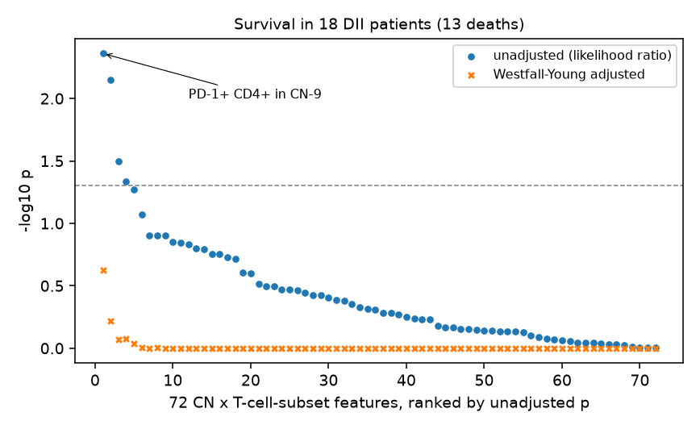

# How robust is a spatial immune biomarker in colorectal cancer?

Multiplexed imaging now measures dozens of proteins in every cell of a tissue section, and papers often report that one cell type, counted only in one spatial neighborhood, predicts survival. Such claims are usually drawn from a few dozen patients and a long list of candidate features. This project re-analyzes one of them. Schürch et al. (Cell, 2020) imaged the invasive front of 35 colorectal cancers with CODEX and found that, in the 18 patients with diffuse inflammatory infiltration, PD-1+ CD4+ T cells inside a granulocyte-rich neighborhood went with longer survival (p = 0.006, 13 deaths).

The analysis first rebuilds the cellular neighborhoods and the survival model from the public single-cell table. It then asks how the association fares after correcting for the 72 neighborhood-specific T-cell features that could have been tested, after resampling the four tissue spots that each patient's value is built from, after dropping one patient at a time, and after correcting the best-cut-point survival curve for its search. A last part asks whether where the cells sit adds anything to how many there are when telling the two immune patterns apart.

The plan, with predictions and the rules for reading the results, is in [docs/design.md](docs/design.md). It was written before the data were downloaded.

Status: done; the readout is [docs/readout.md](docs/readout.md). The association replicates exactly (likelihood-ratio p = 0.0044, R's `coxph` agrees) and holds when any single patient is dropped, but it is the strongest of 72 candidate features and its permutation-adjusted p value is 0.24. Each patient's value comes from four tissue spots that agree poorly (intraclass correlation 0.13), the signal depends on PD-1+ CD4+ calls made outside the CD4+ T-cell clusters, and post hoc it fades (p = 0.29) without the five patients who died within three months of surgery. Location features did not clearly beat cell composition for telling the two immune patterns apart (AUC 0.81 against 0.74, difference interval -0.11 to 0.24).

```
$ python -m codex_crc.replicate data/raw results
                      definition  n  deaths  zero_patients    beta     hr     se  p_wald   p_lr
   main: share of all CN-9 cells 18      13              4 -0.8995 0.4068 0.3245  0.0056 0.0044
       CD4+ T-cell clusters only 18      13             10 -0.3925 0.6753 0.3122  0.2086 0.1846
```



## Run

```
python -m venv .venv
.venv\Scripts\activate            # Windows (macOS or Linux: source .venv/bin/activate)
pip install -e ".[dev]"
pytest
python scripts/download_data.py data/raw
python -m codex_crc.data data/raw/CRC_clusters_neighborhoods_markers.csv results/checks
python -m codex_crc.neighborhoods data/raw/CRC_clusters_neighborhoods_markers.csv results/neighborhoods
python -m codex_crc.replicate data/raw results
python -m codex_crc.robustness data/raw results
python -m codex_crc.partc data/raw results
python -m codex_crc.posthoc_seeds data/raw results
python -m codex_crc.report data/raw results figures
Rscript scripts/check_cox.R results/dii_features.csv
```

The Cox model, the permutation adjustments and the cut-point correction are written out in `survival.py` without a survival package; `check_cox.R` compares the main fit with R's `survival`. Part B takes about a minute and a half on a laptop. Part C reruns the nested leave-one-patient-out fit for each of 1,000 label permutations and takes about 15 minutes on 20 cores.

## Data

Single-cell table: Schürch C. (2020), Mendeley Data, [doi:10.17632/mpjzbtfgfr.1](https://data.mendeley.com/datasets/mpjzbtfgfr/1), CC BY 4.0. Patient table: supplementary Table S1 of Schürch et al. (2020), Cell 182, 1341-1359, [PMC7479520](https://pmc.ncbi.nlm.nih.gov/articles/PMC7479520/). Neither is included in this repository. The code is under the MIT license.

Can Zhang, zhan8639@umn.edu
