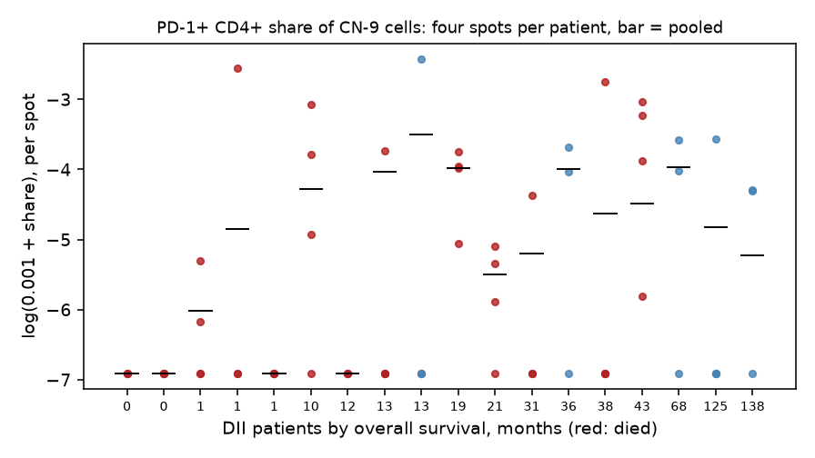
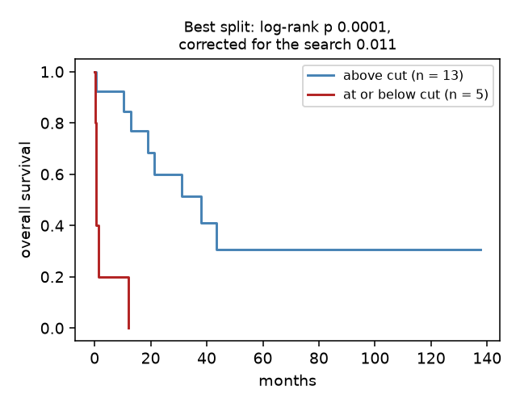
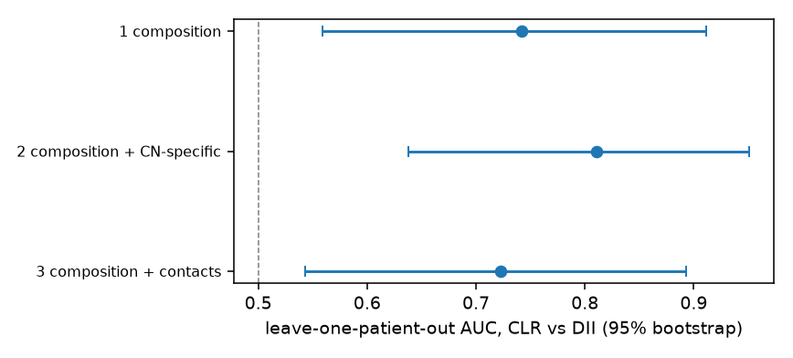

# Readout: how robust is the CN-9 PD-1+ CD4+ survival signal?

Data: Schürch et al. (Cell 2020) CODEX single-cell table (258,385 cells, 35 patients, 140 spots) and their Table S1. Plan and amendments: [design.md](design.md). Every number below is in `results/`.

## Summary

The association the paper reports is in the data and replicates exactly. It also survives several checks: dropping any one patient, changing the pseudocount, using ranks, and rebuilding the neighborhoods with other k-means seeds. It does not survive the checks that matter most for a biomarker claim. Among the 72 neighborhood-specific T-cell features that could have been tested in the same 18 patients, it is the strongest, but its adjusted p value is 0.24. The patient values it rests on are measured with low reliability across each patient's four tissue spots (intraclass correlation 0.13). The signal depends on PD-1+ CD4+ calls made in cells clustered as macrophages, granulocytes or B cells; counted only in CD4+ T-cell clusters, it is weak (p = 0.18). Post hoc, it largely disappears once the five patients who died within three months of surgery are set aside (p = 0.29), most of whom have no PD-1+ CD4+ cell in CN-9. It is best read as a hypothesis for a larger cohort.

## Part A: replication

With the published neighborhood labels, the share of each DII patient's CN-9 cells that carry the PD-1+ CD4+ call, log-transformed with the paper's pseudocount of 0.001, gives a hazard ratio of 0.41 per unit of log share (likelihood-ratio p = 0.0044, Wald p = 0.0056; 18 patients, 13 deaths). The paper reports p = 0.006. The fit agrees with R's `survival::coxph` to four decimals (`results/cox_r_check.txt`), and the proportional hazards test is unremarkable (p = 0.39). The pre-registered replication target is met.

Rebuilding the neighborhoods from 10-nearest-neighbor windows with MiniBatchKMeans gives an adjusted Rand index against the published labels of 0.52 to 0.80 over 20 seeds (median 0.60). The best seed matches every published neighborhood one to one. For the granulocyte neighborhood, 81% to 96% of its cells land in the matched cluster in 19 of the 20 seeds (57% in the remaining one).

## Part B: robustness

| Check | Result | Prediction |
|---|---|---|
| 72 features, Westfall-Young max-T (10,000 permutations) | rank 1 of 72; adjusted p = 0.24 (Holm 0.31) | adjusted p > 0.05: **met** |
| Resampling each patient's four spots (2,000 times) | p < 0.05 in 50% of resamples; log hazard ratio 2.5th to 97.5th percentile -1.02 to -0.10; spot-level ICC 0.13 | under 80%: **met** |
| Leaving out one patient at a time | p < 0.05 in all 18 fits (largest 0.014) | a fit above 0.05: **not met** |
| Pseudocount 0.0001 / 0.01; ranks | p = 0.0034 / 0.0137; 0.0108 | (sensitivity) |
| Calls counted in CD4+ T-cell clusters only | hazard ratio 0.68, p = 0.18 | (sensitivity, amendment 1) |
| Best cut point for the survival curve | log-rank p = 0.0001 unadjusted, 0.011 after correcting for the search | (correction) |

The spot figure shows why the reliability is low. In 14 of the 18 patients, at least two of the four spots have no PD-1+ CD4+ cell in CN-9, and the spread within patients is as wide as the spread between them. The best cut point puts the four patients with no such cell and the patient with the next-lowest value below it.

## Post hoc checks (amendment 2)

Using the cluster matched to CN-9 from each of the 20 k-means rebuilds instead of the published labels gives p < 0.05 for 19 of 20 seeds (range 0.0002 to 0.064), so the clustering run is not what drives the result. Five of the 18 DII patients died within three months of surgery. Three of them are among the four patients with no PD-1+ CD4+ cell in CN-9, and a fourth has the lowest nonzero value. Without these five (13 patients, 8 deaths), the hazard ratio is 0.57 and p = 0.29. Early postoperative deaths may have causes unrelated to antitumor immunity, which would make them a weak basis for an immune biomarker. These two checks were not planned and do not change the verdicts above.

## Part C: does location add to composition?

With the follicle neighborhood, B cells and unclear clusters removed, cell composition alone separates CLR from DII patients with a leave-one-patient-out AUC of 0.74 (95% bootstrap 0.56 to 0.91, permutation p = 0.033). Adding neighborhood-specific frequencies raises it to 0.81 (0.64 to 0.95, p = 0.010), but the difference, 0.07 (-0.11 to 0.24), does not meet the pre-registered rule. Adding Delaunay contact enrichment gives 0.72. With 35 patients, the data cannot show that where the cells sit adds to how many there are.

## Limits

The positivity calls, cell clusters and neighborhood labels are the authors' and are used as given. With 18 patients and 13 deaths, every interval is wide, and the permutation results are the most trustworthy guide. The analysis says nothing about the other findings of the paper, which do not rest on this survival model. The optional graph neural network of the design (Part D) was not run.
